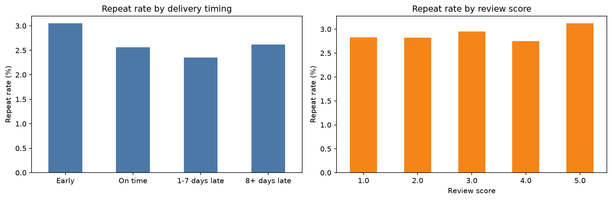

# Olist Customer Retention Analysis (Python)
Part 1: SQL and BigQuery (cohorts, RFM) 
Part 2: Python (why customers don’t return)
https://datastudio.google.com/reporting/9b7b1476-461e-47d0-853a-c7b12acc46d3

## Business question
Only ~3% of Olist customers place a second order. Do late deliveries
or poor reviews explain why customers don't come back?

## Data
Brazilian E-Commerce Public Dataset by Olist (Kaggle), ~100K orders
(2016-2018). Tables used: orders, customers, order reviews.
Link: https://www.kaggle.com/datasets/olistbr/brazilian-ecommerce

## Method
- Kept delivered orders (96,470) and calculated delay = actual vs estimated delivery date
- Used customer_unique_id to identify real customers (customer_id changes per order)
- One row per customer (93,350), judged by their FIRST order
- Compared repeat-purchase rate by delivery timing and review score (pandas)
- Checked group differences with 95% confidence intervals

## Key findings
1. Late delivery sharply lowers satisfaction: avg review 4.29 (early) -> 2.71 (1-7 days late) -> 1.69 (8+ days late).
2. Late delivery is associated with a modest drop in repeat purchases: 2.47% vs 3.04%.
3. Retention is low even for satisfied customers: 5-star reviewers return at only 3.12%.

## Recommendations
- Reduce late deliveries and set realistic delivery estimates
- Proactively contact late-delivery customers (apology/voucher)
- Invest in re-engagement (post-purchase emails, coupons, cross-category offers)

## Limitations
- Shows association, not causation
- ~2 years of data, so recent customers had little time to return
- 616 customers left no review
- Repeat rate uses each customer's first order only

## Tools
Python, pandas, matplotlib

